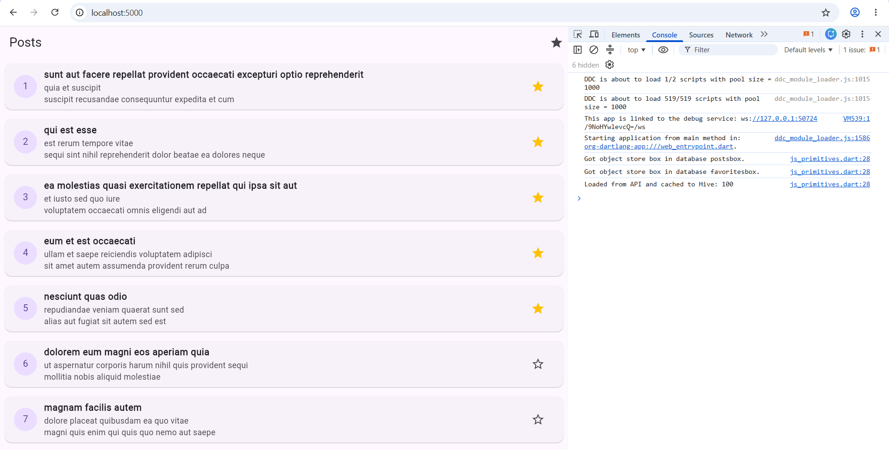
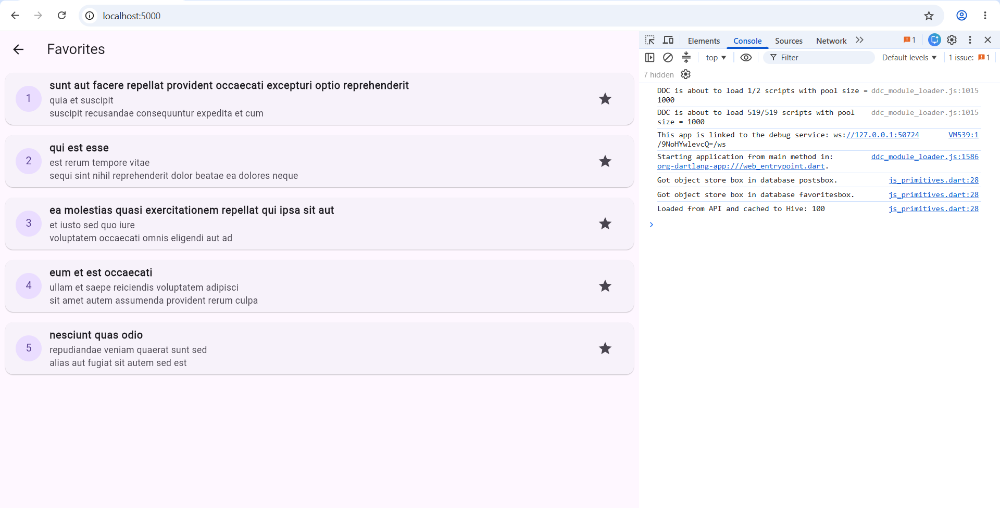
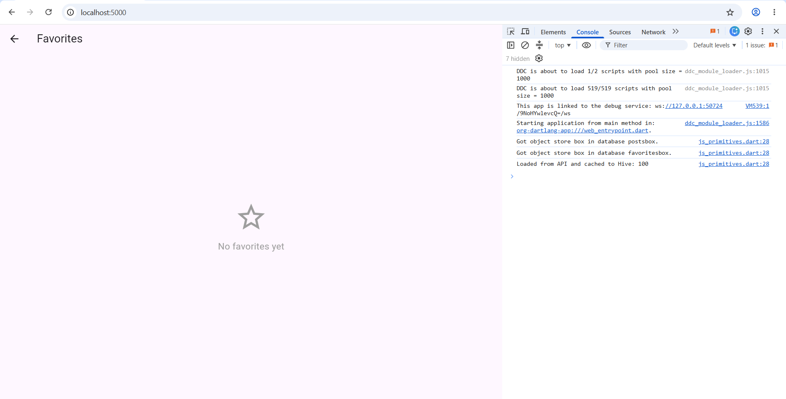
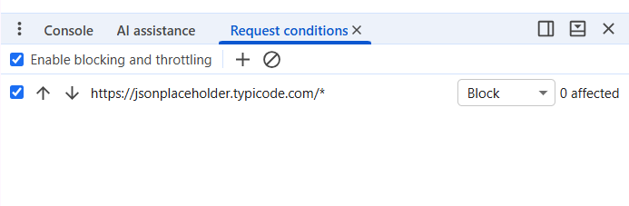

# Offline Posts App (Flutter + Hive)

A Flutter app that fetches posts from the [JSONPlaceholder API](https://jsonplaceholder.typicode.com/posts), caches them locally with **Hive**, and lets the user save **favorites** in a separate Hive box. Posts and favorites persist across refreshes and restarts, and are available when the API is unreachable.

**Author:** Youssef Samir | **ID:** 23010020

## Features

- Fetch posts from the API and cache them in Hive (`postsBox`)
- Offline fallback: if the API fails, the last saved posts are shown
- Friendly error when there is no internet **and** no cached data
- Pull-to-refresh
- Favorite / un-favorite a post with a star icon (updates instantly)
- Favorites screen using the same card design
- "No favorites yet" empty state
- Favorites stored in their own box (`favoritesBox`) so refreshes never wipe them

## Tech Stack

| Package | Purpose |
|---|---|
| `http` | API requests |
| `hive` / `hive_flutter` | Local NoSQL database |
| `hive_generator` / `build_runner` | Generates the `Post` TypeAdapter |
| `connectivity_plus` | Listed in the lab setup (not used by the app logic) |

## Project Structure

```
lib/
├── main.dart                     // init Hive, register adapter, open boxes, run app
├── models/
│   ├── post_model.dart           // Post class + Hive annotations
│   └── post_model.g.dart         // generated (do not edit)
├── services/
│   ├── post_service.dart         // API first, Hive as fallback
│   └── favorites_service.dart    // toggleFavorite / isFavorite / getFavorites
└── screens/
    ├── posts_screen.dart         // posts list + star button + AppBar action
    └── favorites_screen.dart     // list of saved favorites
```

## Design

**Data flow:** `API -> Hive -> ListView`

`PostService.getPosts()`:
1. Opens `postsBox`
2. Tries the API
3. On success: clears the box, saves the new posts, returns them
4. On failure: returns cached posts if available, otherwise throws `No Internet and No Cached Data`

**Why a separate favorites box?** `getPosts()` calls `postsBox.clear()` on every refresh. Favorites in the same box would be wiped. Also, a `HiveObject` can only live in one box, so a **copy** of the `Post` is saved to `favoritesBox`.

**Why `post.id` as the key?** `containsKey(id)` and `delete(id)` are O(1), and a post can never be saved twice.

**UI updates:** `ValueListenableBuilder` with `box.listenable()` rebuilds the stars and the Favorites screen automatically whenever the box changes.

## Getting Started

```bash
flutter pub get
dart run build_runner build --delete-conflicting-outputs
flutter run -d chrome --web-port=5000
```

## How the Offline Mode Was Tested

The app was tested on **Flutter Web (Chrome)**, because Windows Developer Mode was blocked on my machine and the Android emulator did not fit on my disk. A real airplane mode was therefore **not** used. Instead, I simulated the API being unreachable:

1. Run the app with internet on, so the posts load and are cached to Hive (`Loaded from API and cached to Hive: 100`).
2. Star some posts so they are saved in `favoritesBox`.
3. In Chrome DevTools, open **Request conditions** (network request blocking) and add a **Block** rule for `https://jsonplaceholder.typicode.com/*`.
4. Hot restart the app (`R` in the terminal).

The blocked request makes `http.get` fail, which is the same code path that runs when the device has no internet. The console shows the failure and the fallback:

```
Request was blocked by DevTools: https://jsonplaceholder.typicode.com/posts
API Failed, reason: ClientException: Failed to fetch ...
Loaded from Hive offline: 100
```

I used request blocking and not DevTools' "Offline" throttle because "Offline" also cuts the connection to the local debug server and breaks hot restart.

Note: on the web, Hive stores data in the browser's IndexedDB, which is per-origin (host + port). The app is run on a fixed port (`--web-port=5000`) so stored data is found again after a restart.

## Screenshots

### 1. Posts loaded from the API (online)
Console: `Loaded from API and cached to Hive: 100`


### 2. Posts added to favorites (filled stars)


### 3. Favorites screen with saved posts


### 4. Empty state: "No favorites yet"


### 5. Simulating offline: the API request is blocked in Chrome DevTools


### 6. Offline: posts still load from Hive, favorites still starred
Console: `API Failed ...` then `Loaded from Hive offline: 100`


### 7. Offline: Favorites screen still shows the saved favorites

