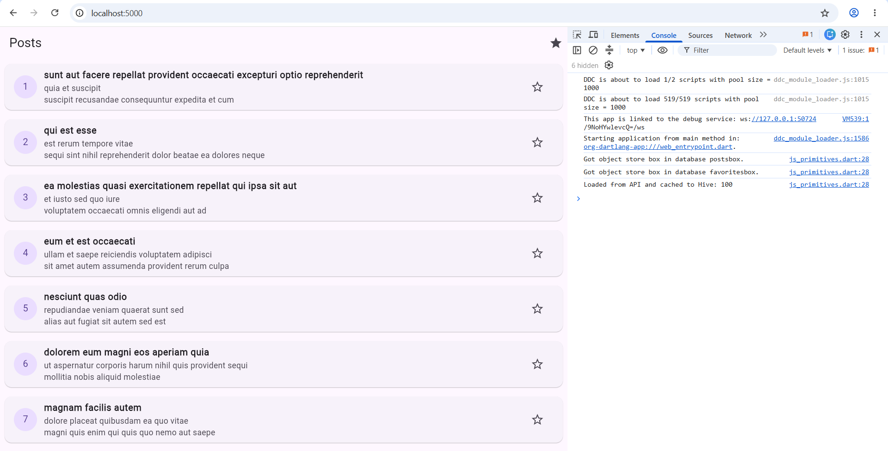
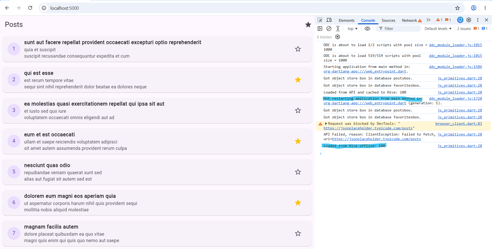
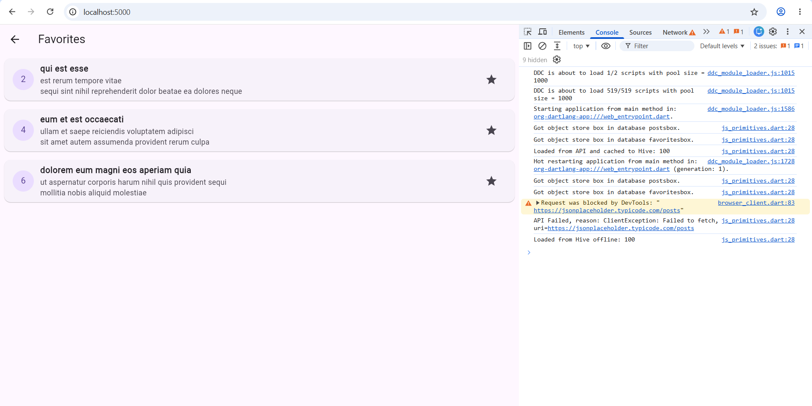

# Offline Posts App (Flutter + Hive)

A Flutter app that fetches posts from the [JSONPlaceholder API](https://jsonplaceholder.typicode.com/posts), caches them locally with **Hive**, and lets the user save **favorites** that persist across refreshes and app restarts, even without internet.

## Features

- Fetch posts from the API and cache them in Hive (`postsBox`)
- Offline mode: if the API fails, the last saved posts are shown
- Friendly error when there is no internet **and** no cached data
- Pull-to-refresh
- Favorite / un-favorite a post with a star icon (updates instantly)
- Favorites screen with the same card design
- "No favorites yet" empty state
- Favorites stored in a separate box (`favoritesBox`) so they survive refreshes

## Tech Stack

| Package | Purpose |
|---|---|
| `http` | API requests |
| `hive` / `hive_flutter` | Local NoSQL database |
| `hive_generator` / `build_runner` | Generates the `Post` TypeAdapter |
| `connectivity_plus` | Declared in the lab setup (connectivity handling) |

## Project Structure

```
lib/
├── main.dart                     // init Hive, register adapter, open boxes, run app
├── models/
│   ├── post_model.dart           // Post class + Hive annotations
│   └── post_model.g.dart         // generated (do not edit)
├── services/
│   ├── post_service.dart         // API first, Hive as fallback
│   └── favorites_service.dart    // toggleFavorite / isFavorite / getFavorites
└── screens/
    ├── posts_screen.dart         // posts list + star button + AppBar action
    └── favorites_screen.dart     // list of saved favorites
```

## Design

**Data flow:** `API -> Hive -> ListView`

`PostService.getPosts()`:
1. Opens `postsBox`
2. Tries the API
3. On success: clears the box, saves the new posts, returns them
4. On failure: returns cached posts if available, otherwise throws `No Internet and No Cached Data`

**Why a separate favorites box?** `getPosts()` calls `postsBox.clear()` on every refresh. Favorites in the same box would be wiped. Also, a `HiveObject` can only live in one box, so a **copy** of the `Post` is saved to `favoritesBox`.

**Why `post.id` as the key?** `containsKey(id)` and `delete(id)` are O(1) and a post can never be saved twice.

**UI updates:** `ValueListenableBuilder` with `box.listenable()` rebuilds the stars and the Favorites screen automatically whenever the box changes.

## Getting Started

```bash
git clone <your-repo-url>
cd offline_posts_app
flutter pub get
dart run build_runner build --delete-conflicting-outputs
flutter run
```

## Screenshots

### 1. Posts loaded from the API (online)
<!-- Console should show: "Loaded from API and cached to Hive" -->


### 2. Adding a post to favorites (filled star)


### 3. Removing a post from favorites (outlined star)


### 4. Favorites screen with saved posts


### 5. Empty favorites state ("No favorites yet")


### 6. Offline mode - posts still load from Hive
<!-- Console should show: "Loaded from Hive offline" -->


### 7. Offline proof - favorites persist after restart in airplane mode


### 8. No internet and no cache (fresh install, airplane mode)


## Offline Test Procedure

| # | Action | Expected result |
|---|---|---|
| 1 | Run the app with internet on | Posts load; console prints `Loaded from API and cached to Hive` |
| 2 | Favorite a few posts | Stars become filled |
| 3 | Close the app and enable airplane mode | - |
| 4 | Reopen the app | Posts still appear (`Loaded from Hive offline`); favorites are still there |
| 5 | Uninstall, enable airplane mode, run | Error: `No Internet and No Cached Data` |

## Author

<!-- Youssef Samir victor, 23010020 -->
